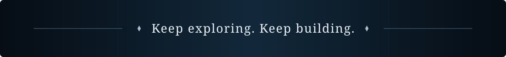

  

  <a href="https://www.sahaddaily.in"><b>Portfolio</b></a>
  &nbsp; · &nbsp;
  <a href="https://www.linkedin.com/in/sahad-pop/"><b>LinkedIn</b></a>
  &nbsp; · &nbsp;
  <a href="mailto:msahad124@gmail.com"><b>Email</b></a>
  &nbsp; · &nbsp;
  <a href="https://github.com/Sahad-09?tab=repositories"><b>Repositories</b></a>

 

## Ⅰ · The explorer

I'm **Sahad**, a full stack developer and AI engineer. I build web interfaces, backend services, and AI applications—with a particular interest in how they work together as a complete product.

Previously, I ran **Sahad Daily**, a web agency. These days, I'm exploring **DSPy, retrieval-augmented generation, and Hono**, and I'm open to collaborating on open-source projects.

> Thoughtful interfaces. Useful intelligence. The systems underneath.

 

## Ⅱ · Selected expeditions

Three paths through my public work. Each leads to the source.

### [01 / Company Discovery ↗](https://github.com/Sahad-09/company-discovery)

Find NSE-listed companies through natural-language themes and market narratives. A semantic search interface backed by OpenAI embeddings and Qdrant vector search.

**Next.js · TypeScript · OpenAI · Qdrant**

### [02 / React Hooks ↗](https://github.com/Sahad-09/React-hooks)

A learning project that explores React hooks through practical examples and straightforward explanations.

**React · TypeScript**

### [03 / AI Agent Backend ↗](https://github.com/Sahad-09/insider-trade-backend-chat-agent)

A FastAPI and LangGraph agent backend with streaming chat, persistent state, vector storage, and LLM observability.

**Python · FastAPI · LangGraph · PostgreSQL**

 

## Ⅲ · The toolkit

| Layer | What I work with |
| :--- | :--- |
| **Interfaces** | TypeScript, JavaScript, React, Next.js, Tailwind CSS, Zustand |
| **Services** | Python, Node.js, Express, NestJS, FastAPI, Django |
| **AI systems** | RAG, DSPy, semantic routing, OpenAI, Gemini, Qdrant |
| **Data** | PostgreSQL, MongoDB, Redis, Supabase, Prisma |
| **Delivery** | Docker, AWS, Cloudflare, Vercel, Linux, Git |

<b>Open the rest of the inventory</b>

 

- **Languages & creative tools:** Java, HTML, CSS, Bash, Electron, Blender
- **Interface libraries:** Redux, Bootstrap
- **Data & messaging:** MySQL, RabbitMQ
- **Architecture & processing:** event-driven systems, microservices, ETL, Celery, server-sent events
- **Testing & operations:** Postman, Selenium, Prometheus
- **Web extraction:** BeautifulSoup

 

## Ⅳ · At the workbench

**Exploring** · DSPy programs, retrieval systems, and lightweight APIs with Hono.

**Open to** · Collaborations on AI tools, full stack applications, and open-source projects.

Have something interesting to build? **[Leave a message →](mailto:msahad124@gmail.com)**

 

  

  <a href="https://www.instagram.com/sahad__.x/">Instagram</a> &nbsp; · &nbsp; <a href="https://www.youtube.com/channel/UCVOR8gU2bH6oU3kRCPX1Cvw">YouTube</a> &nbsp; · &nbsp; <a href="https://www.sahaddaily.in">sahaddaily.in</a>

