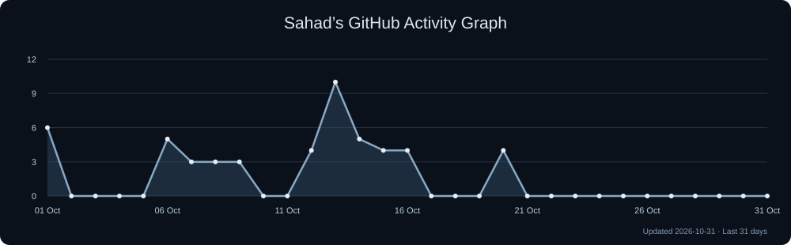

  <picture>
    <source media="(prefers-reduced-motion: reduce)" srcset="./assets/moonlit-title.png" />
    
  </picture>

  <h1 align="center">Hi , I'm Sahad</h1>

  

 

## 🙋‍♂️ About Me
- 🔭 I used to run an agency **"Sahad Daily"**
- 🌱 I’m currently exploring **DSPy, RAG Systems, and Hono**
- 👯 I’m looking to collaborate on **OpenSource Projects**
- 📫 Reach me at **msahad124@gmail.com**

 

## 🧠 AI & Machine Learning Arsenal

  
  
  
  
  

## 🚀 Languages & Tools

  <h3>Frontend & Core Languages</h3>
  
   
  

   

  <h3>Backend, Data & Architecture</h3>
  
   
  

   

  <h3>DevOps, Cloud & Tools</h3>
  

 

## 🛠️ Specialized Technical Concepts

  
  
  
  
  
  
  

 

## 📊 GitHub Analytics

  

## 🤝 Connect with me

  
  
  

